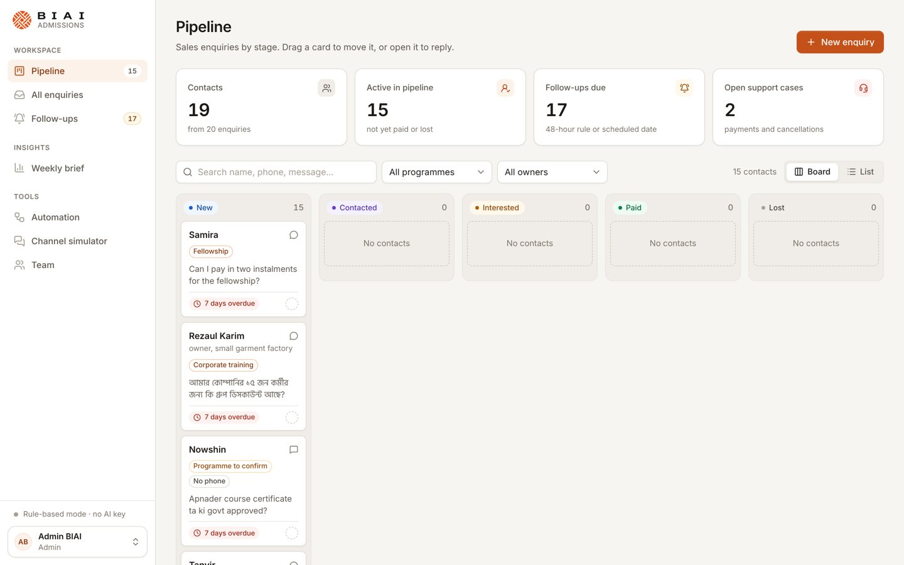
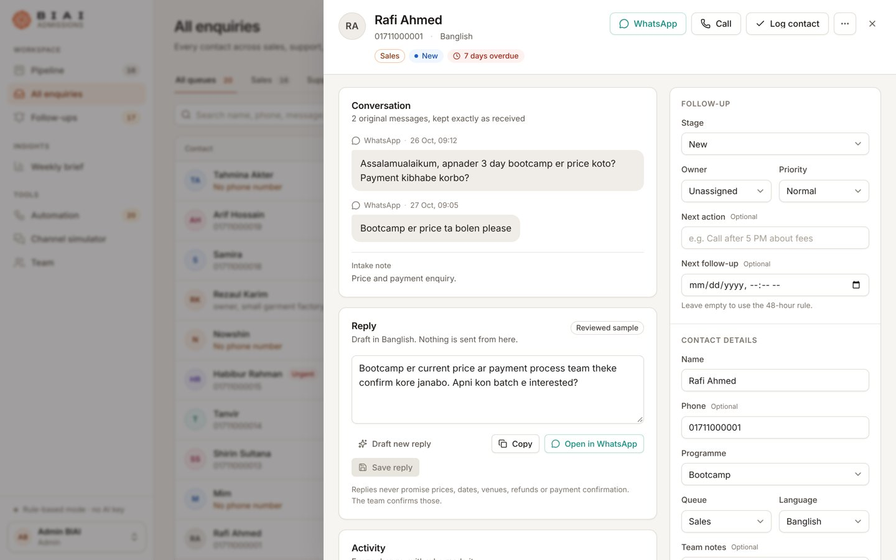
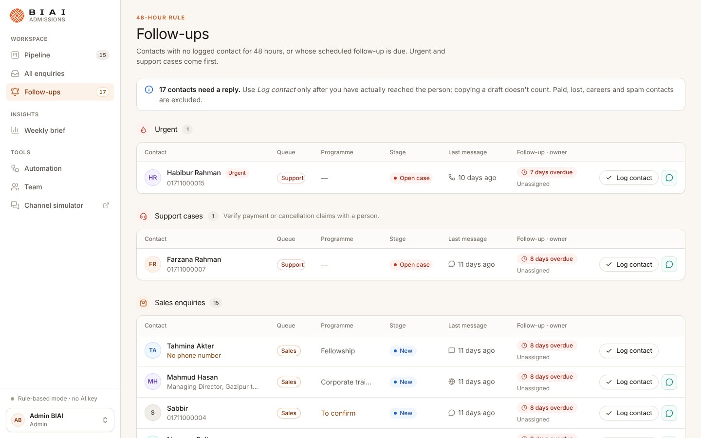
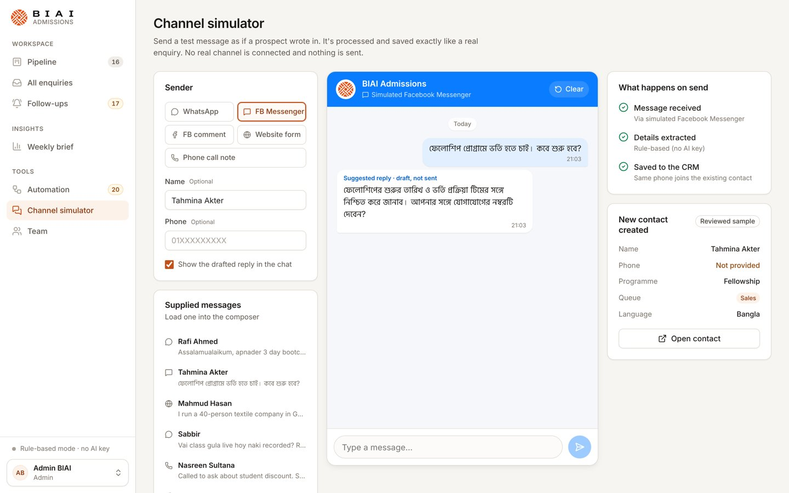

# BIAI Admissions CRM

An admissions and enquiry CRM for Bangladesh AI (BIAI), with a separate **channel simulator** website for sending test enquiries into it.

Enquiries arrive from WhatsApp, Facebook, the website and phone calls, in Bangla, Banglish and English. The CRM extracts each sender's details with AI and routes them to Sales, Support, Careers or Spam. It drafts a reply in the sender's language and tracks every contact through a five-stage pipeline, so nobody waits more than 48 hours for a follow-up.

**Live demo**

| | |
|---|---|
| CRM | https://biai-crm.boraqs.com |
| Channel simulator | https://biai-simulator.boraqs.com |
| Demo sign-in | `admin@biai.com.bd` / `Admin123!` (also `tanvir@`, `ayesha@`, `rahim@`; same password) |

The CRM is seeded with 20 fictional sample messages, which become 19 contacts.

| Pipeline | Contact |
|---|---|
|  |  |
| **Follow-ups** | **Channel simulator** |
|  |  |

## Features

- **Pipeline:** five stages: New, Contacted, Interested, Paid and Lost. Drag cards between stages (each move is saved and logged), or switch to a list.
- **All enquiries:** every contact across the Sales, Support, Careers and Spam queues. Filter by programme, owner or text.
- **Follow-ups:** contacts with no logged contact for 48 hours, or whose scheduled follow-up date has passed. Grouped as Urgent, then Support, then Sales, with a one-click **Log contact**.
- **Contact panel:**
  - The full conversation, with the reply draft beside it.
  - The contact's details and stage.
  - A history of who changed what.
- **New enquiry:** paste a message to get the extracted details and a draft reply, then review and save. A message with a known phone number joins the existing contact; a message with no phone is never merged.
- **Weekly brief:** totals calculated by code for any seven days, plus three AI-written priorities. It can be copied as text.
- **Automation:**
  - **Manual mode:** every new enquiry waits for a person.
  - **Automatic mode:** complete sales enquiries are saved on their own. Every exception, such as a missing phone or a support case, is held for review.
  - **Safe auto-reply** for channel messages: optional and off by default.
- **Team and roles:** Admin, Admissions, Support and Sales, with permissions enforced by the API.
- **Channel simulator:** a separate website where you write in as a prospective student. The message goes to the CRM's inbound API, which is authenticated with a channel key, not a staff login, and is saved like a real enquiry.

### Safety rules

- Nothing is sent to a real customer. WhatsApp and call buttons open the staff member's own app.
- Replies are checked in code for:
  - prices, dates and guarantees
  - payment confirmations
  - claims that something has already been done
  - outside links
  - a different language from the sender's

  A reply that breaks a rule gets one AI rewrite. If it still fails, it is never sent automatically.
- A reported payment never marks a contact as Paid; it goes to Support for a person to check.
- Unknown details stay unknown: a programme the sender didn't name stays "to confirm", and a missing phone stays blank and is flagged.
- Without an AI key, the app uses a rule-based extractor that is clearly labelled, so it never passes itself off as AI output.

## Tech stack

| Part | Built with |
|---|---|
| CRM client | React 19, TypeScript, Vite, React Router, TanStack Query, CSS Modules with design tokens |
| Channel simulator | React and TypeScript, a separate static site |
| API | Node.js 22+, Express 5, zod validation, helmet, rate limiting; organised as routes → services → repositories |
| Database | PostgreSQL 12 or newer, with versioned SQL migrations |
| Auth | bcrypt passwords, a JWT in an httpOnly SameSite cookie, role checks and a same-origin check |
| AI | Meta, Gemini or OpenAI structured JSON output, with retries and server-side validation |
| Tests | `node:test`: 57 unit and integration tests against a real PostgreSQL database |
| CI/CD | GitHub Actions: tests on PostgreSQL 12 and 16, and an automatic cPanel deploy over FTPS |

## Getting started

You need Node.js 22+ and Docker, or your own PostgreSQL.

1. Copy the example settings:
   ```bash
   cp .env.example .env
   ```
2. Install dependencies:
   ```bash
   npm install
   ```
3. Start PostgreSQL in Docker:
   ```bash
   npm run db:up
   ```
4. Start everything:
   ```bash
   npm run dev
   ```

Step 4 starts three processes:

| Process | Address |
|---|---|
| API | http://localhost:4000 |
| CRM | http://localhost:5173 |
| Channel simulator | http://localhost:5174 |

On first start, the server applies the migrations, creates the demo team and imports the sample enquiries.

If you already run PostgreSQL, skip step 3. Create a `biai_crm` database instead and set `DATABASE_URL` in `.env`.

To run the production build (one process serves the API and the CRM on :4000):

```bash
npm run build
```

```bash
npm start
```

### Live AI (optional)

Set one AI provider in `.env`, then restart:

| Provider | Settings |
|---|---|
| Meta | `MODEL_API_KEY` and `META_MODEL` |
| Gemini | `GEMINI_API_KEY` |
| OpenAI | `OPENAI_API_KEY` |

API keys stay on the server and are never sent to the browser. If an AI call fails, the app falls back to the rule-based extractor and shows `Live AI unavailable`. To check AI quality, `npm run evaluate:ai -w server` runs the 20 samples against the live model and reports the results.

## Scripts

| Command | What it does |
|---|---|
| `npm run dev` | Run the API, CRM and simulator together |
| `npm run build` | Type-check and build both web apps |
| `npm start` | Run the production server |
| `npm test` | Run the server's unit and integration tests |
| `npm run check` | Type-check, build and test |
| `npm run bundle` | Build the cPanel deploy folder `deploy/crm` |
| `npm run db:up` | Start PostgreSQL in Docker |
| `npm run db:migrate` / `db:seed` / `db:reset` | Apply migrations, seed an empty database, or restore the sample data |

The integration tests use `TEST_DATABASE_URL`, which defaults to `biai_crm_test` on the Docker PostgreSQL. They are skipped if that database isn't reachable. **They wipe and recreate that database**, so never point it at real data. To create it:

```bash
docker compose exec db createdb -U biai biai_crm_test
```

## Project structure

```
aibi-crm/
├── client/                  CRM web app
│   └── src/
│       ├── app/             root, router
│       ├── api/             typed API client
│       ├── components/      ui/ (design system) and layout/ (shell, sidebar)
│       ├── features/        one folder per area: pipeline, enquiries, followups,
│       │                    contact, intake, brief, automation, team, auth
│       ├── hooks/  lib/  styles/  types/
├── simulator/               channel simulator website
│   └── src/                 App, components/, lib/ (inbound API client), styles/
├── server/                  Express API
│   ├── src/
│   │   ├── modules/         auth, users, leads, intake, automation, reports,
│   │   │                    channels, meta, admin: each *.routes → *.service → *.repository
│   │   ├── domain/          business rules: stages, phone numbers, 48-hour rule
│   │   ├── services/ai/     provider calls, prompts, reply policy, rule-based fallback
│   │   ├── db/              pool, migrations, seed
│   │   ├── middleware/      auth, roles, validation, errors
│   │   └── config/          validated settings
│   ├── scripts/             cPanel bundle, AI evaluation
│   └── tests/               unit/ and integration/
├── docs/                    deployment, cPanel setup, QA report, brand notes
└── .github/workflows/       ci.yml, deploy-cpanel.yml
```

## API

Every route is under `/api`. The `/channels/*` routes need the `X-Channel-Key` header. Every other route except `/health` and `/auth/login` needs a signed-in staff session.

| Route | Purpose | Who can use it |
|---|---|---|
| `POST /auth/login` · `POST /auth/logout` · `GET /auth/me` | Sign in, sign out, current session | anyone |
| `GET /leads` · `GET /leads/:id` · `PATCH /leads/:id` | List, view and edit contacts | any staff |
| `POST /leads/:id/contact` · `POST /leads/:id/draft` | Log a contact; draft a reply | any staff |
| `DELETE /leads/:id` | Delete a contact | Admin |
| `POST /intake/analyze` · `POST /intake` | Extract details from a message; save a reviewed enquiry | any staff |
| `GET /automation` · `POST /automation/jobs/:id/review` | Automated intake and its review queue | any staff |
| `PUT /automation/settings` | Switch between manual and automatic mode | Admin, Admissions |
| `GET /reports/weekly` | Weekly brief | any staff |
| `GET /channels/info` · `POST /channels/inbound` | Inbound channel API used by the simulator | channel key |
| `GET /users` · `POST /users` | List the team; add a member (Admin only) | any staff / Admin |
| `POST /admin/reset-demo` | Restore the sample data | Admin |

## Deployment

Every push to `main` that changes the app is deployed by GitHub Actions. The workflow:

1. Builds both sites and bundles the API into one file.
2. Uploads them to cPanel over FTPS.
3. Restarts the Node.js app.
4. Checks that both live sites respond.

The one-time server setup is in [docs/cpanel-setup.md](docs/cpanel-setup.md). For Docker and other hosts, see [docs/DEPLOYMENT.md](docs/DEPLOYMENT.md).

## Limitations

- There are no live WhatsApp or Facebook connections. The channel simulator stands in for them.
- The app never verifies payments.
- Reminders appear in the app only; there are no emails or push notifications.
- The demo accounts share a published password. Change it before any real use.

More detail: [QA report](docs/QA.md) · [Brand notes](docs/BRAND.md)
